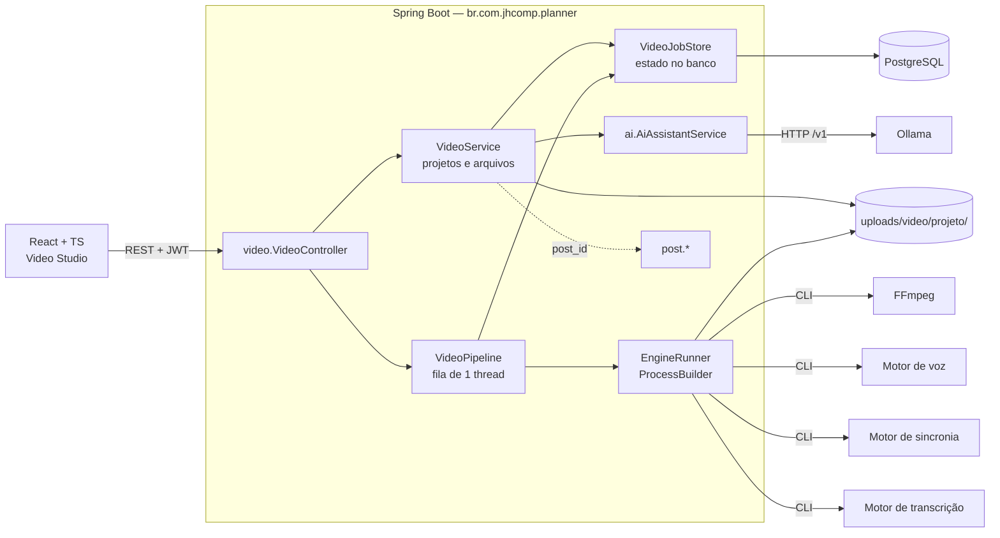
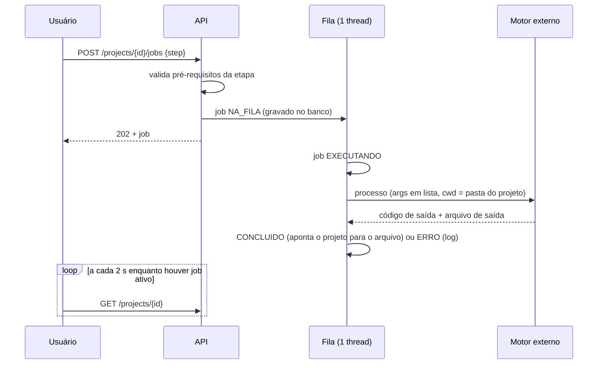

# 03 — Arquitetura

## Decisão

**Monólito modular com motores externos chamados como processo.** O Spring Boot continua
sendo a única aplicação: cria jobs, guarda estado, controla arquivos e acesso. Voz,
sincronia labial e transcrição são programas à parte, iniciados pelo backend por linha de
comando, que leem arquivos e escrevem um arquivo. Eles não conhecem o banco nem a API.

Alternativas descartadas estão em 09. Em resumo: microsserviços e mensageria resolvem
problemas (vários times, várias máquinas, alta concorrência) que uma ferramenta de um
usuário numa GPU não tem.

## Componentes



O pacote `video` depende de `ai` (roteiro) e referencia `post` só por id. Ninguém depende
de `video`. Não há ciclo.

## Fluxo de processamento



## Etapas e dependências

| Etapa | Entrada | Saída | Motor | Sem motor |
|---|---|---|---|---|
| VOZ | roteiro | `audio` | `voice-command` | envie o áudio |
| LIPSYNC | vídeo-base + áudio | `lipsync` | `lipsync-command` | o render usa o vídeo-base |
| LEGENDAS | áudio | `subtitles` (.srt) | `transcribe-command` | escreva ou cole o SRT |
| RENDER | (lipsync ou base) + áudio opcional + srt opcional | `final` (.mp4) | FFmpeg | — |

Trocar uma entrada invalida só o que vem depois dela: novo áudio apaga sincronia,
legendas e final; novo vídeo-base apaga sincronia e final; editar legendas apaga só o final.

## Comunicação com os motores

Cada motor é um **modelo de comando** em configuração, com marcadores:

```
VIDEO_LIPSYNC_COMMAND=wsl -d Ubuntu /opt/engines/lipsync.sh {video} {audio} {out}
```

`{text}` (arquivo .txt com o roteiro), `{audio}`, `{video}`, `{out}`. O backend monta a
lista de argumentos — nunca uma string para um shell —, define a pasta do projeto como
diretório de trabalho e passa nomes de arquivo gerados por ele (UUID). O texto do roteiro
vai por arquivo, não por argumento. Quem adapta o motor ao contrato é um script fino de
5 a 10 linhas por motor (exemplos em 08).

Por que CLI e não HTTP: carregar o modelo, processar e sair **é** o gerenciamento de VRAM
(ver abaixo), e não exige manter serviço nenhum de pé. O ponto de extensão para HTTP é o
`EngineRunner`: quando o backend rodar em contêiner e os motores no host, troca-se a
execução por uma chamada a `host.docker.internal` sem tocar em `VideoPipeline`.

## GPU

- A fila tem **uma** thread: dois jobs nunca disputam a placa.
- Motor por processo: ao terminar, o sistema operacional devolve toda a VRAM. Não há
  modelo residente a descarregar.
- O Ollama mantém o modelo carregado por 5 minutos por padrão. Antes de um job de GPU,
  convém `OLLAMA_KEEP_ALIVE=0` ou um modelo pequeno — ver 05.
- FFmpeg roda em CPU (`libx264`); o Ryzen 9 7900X dá conta de um reel em segundos.

## Armazenamento

```
uploads/video/<id do projeto>/
  base-<uuid>.mp4        vídeo enviado
  audio-<uuid>.wav       áudio enviado ou gerado
  lipsync-<uuid>.mp4     saída da sincronia
  subtitles-<uuid>.srt
  final-<uuid>.mp4       render
  roteiro.txt            temporário, entrada do motor de voz
```

Uma pasta por projeto; apagar o projeto apaga a pasta. Ao substituir um arquivo, o
anterior é removido — o histórico fica nos jobs (quando rodou, quanto levou, o log), não
em cópias de gigabytes. Fica dentro do volume `uploads` que o compose já persiste.

## Navegação planejada

Hoje a barra tem sete abas planas. Com mais módulos ela não escala; o desenho proposto
(não implementado) agrupa em **Planner** (Feed, Posts, Copy, Editor, Templates),
**Video Studio**, **IA**, **Analytics** e **Configurações** (Instagram, conta). Nesta
etapa o Video Studio entrou como mais uma aba, sem mexer nas existentes.
