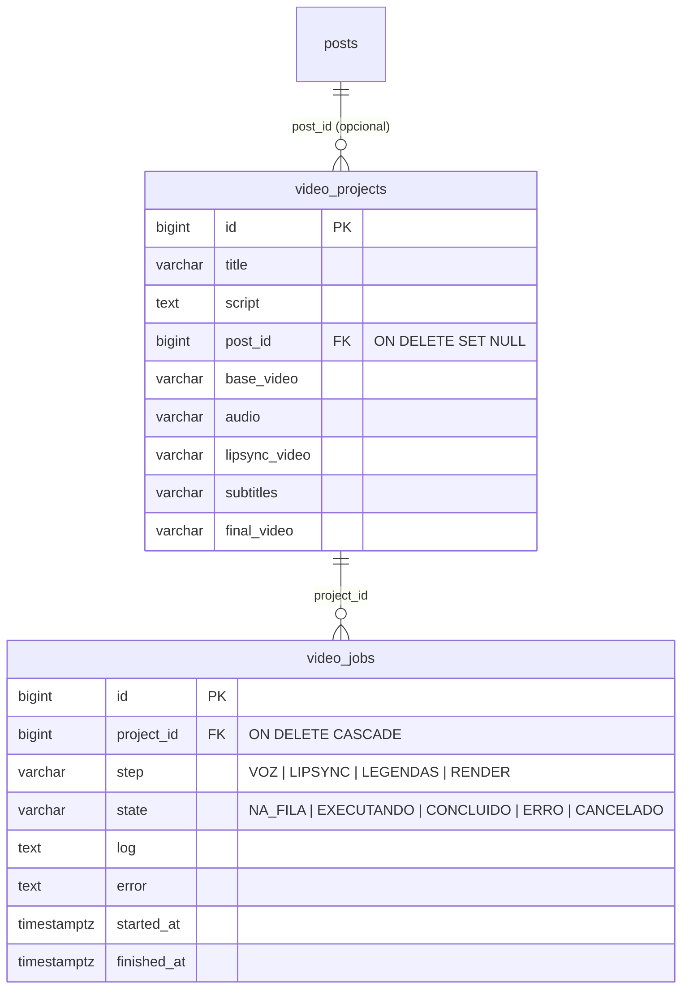

# 04 — Modelo de dados

## O que existe

`posts` (+ `post_slides`), `copy_entries`, `tones`, `hashtag_blocks`, `template_assets`,
`app_settings`, `instagram_accounts`, `app_users`, `ai_usage`. Todas as entidades herdam
`BaseEntity` (`id`, `created_at`, `updated_at`). Migrações Flyway `V1`–`V11`, com
`ddl-auto: validate` — o Hibernate nunca altera o esquema.

## O que entra (V12)

As cinco colunas de arquivo guardam só o **nome** do arquivo dentro da pasta do projeto,
nunca um caminho: o caminho é sempre `raiz/<id>/<nome>`, montado e conferido pelo backend.

## Como os conceitos pedidos foram mapeados

| Conceito | Onde ficou | Por quê |
|---|---|---|
| ContentPublication | `posts` (já existe) | Criar outra tabela duplicaria título, legenda, status e agenda |
| ContentProject | `video_projects` | Só existe um tipo de projeto além do post; uma tabela genérica com uma linha de tipo não paga o custo |
| VideoScript | coluna `video_projects.script` | Um roteiro por projeto; versões de roteiro não foram pedidas |
| ContentAsset | colunas de arquivo em `video_projects` | São cinco papéis fixos; uma tabela de assets vale quando houver biblioteca de mídia (fase 5) |
| VideoJob | `video_jobs` | — |
| VideoRender | jobs com `step = RENDER` + `final_video` | O histórico de renderizações é o histórico de jobs |
| VoiceProfile | configuração do motor de voz | Um usuário, uma voz; vira tabela quando houver mais de um perfil |
| Campaign | não criado | Fase 5; entra como `campaigns` + `posts.campaign_id` |

## Sem duplicar Planner e Video Studio

O vídeo não copia nada do post. Título e roteiro do projeto são do vídeo; legenda,
hashtags, status e data continuam só em `posts`. A ligação é `video_projects.post_id`: o
post lista seus vídeos por consulta, e apagar o post solta o vídeo em vez de apagá-lo
(`SET NULL`) — um render de minutos não deve sumir por causa de um rascunho descartado.

## Evolução prevista (não criada)

- `media_assets` (biblioteca): quando um mesmo vídeo-base servir a vários projetos.
- `voice_profiles`: quando houver mais de uma voz de referência.
- `campaigns` e `post_metrics` (Analytics): dependem da Graph API do Instagram
  (`/insights`), cujas permissões precisam ser conferidas antes — ver roadmap.
